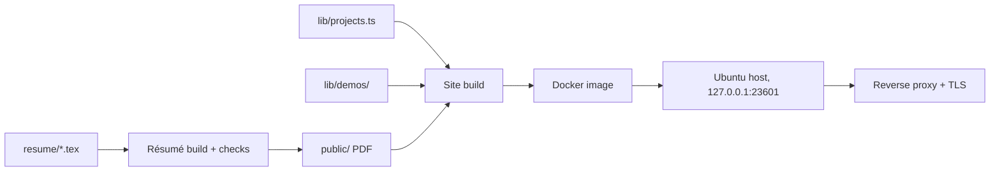

# eesherj.com

This is the source for my portfolio site, [eesherj.com](https://eesherj.com). It is one page about me and my work, plus a write-up for each of three projects: [TriageCI](https://eesherj.com/projects/triageci), [RaftKV](https://eesherj.com/projects/raftkv) and [SyncLab](https://eesherj.com/projects/synclab). My résumé is at [eesherj.com/Eesher_Janda_Resume.pdf](https://eesherj.com/Eesher_Janda_Resume.pdf), built from the LaTeX source in this repo.

## What is on the site

Each project write-up covers the problem, how it works, the decisions I made, how I tested it and what it still cannot do. Every number on the site is on my résumé or in the linked project repo, with the workload and machine it was measured on. I did not rerun any benchmarks for the website. Links to evidence are pinned to the project commit I checked the write-up against.

Each write-up also has a small demo that runs in your browser:

- **TriageCI** runs a copy of the real classifier on sample test histories. You can add passing or failing runs and watch the label change.
- **SyncLab** runs the real CRDT code with two copies of a document. Disconnect them, type in both, reconnect, and they end up identical even though the queued edits are replayed out of order and twice.
- **RaftKV** is a hand-written step-through of a leader failure. It does not run the Java cluster.

The demos make no network requests and do not store anything you type. The small figures on the home page are computed at build time from the same demo code, so the TriageCI labels and SyncLab text are real output.

## Run it

You need Node.js 22.13+, pnpm 11, a LaTeX compiler and the Poppler utilities (the résumé build checks the PDF with them).

```bash
git clone https://github.com/EesherJ39/portfolio.git
cd portfolio
pnpm install --frozen-lockfile
pnpm dev
```

Open the URL the dev server prints. `pnpm dev` rebuilds the résumé before starting the site.

## Checks

```bash
pnpm resume:build
pnpm exec tsc --noEmit
pnpm lint
node --experimental-strip-types --test tests/*.test.mjs
pnpm build
```

The tests cover the demo logic, the home-page figures, the pinned evidence links, page navigation and the résumé (a one-page Letter PDF with searchable text and nothing running off the page). They also fail if an em dash or a few stock phrases show up in the site copy. The deploy script has its own tests in `deploy/test_auto_deploy.py`.

The résumé source is [`resume/Eesher_Janda_Resume.tex`](resume/Eesher_Janda_Resume.tex). The PDF in `public/` is generated by the build and is not checked in. When a fact changes, I update the résumé first and then the site.

## How it is built

The site is React 19 on vinext, set in Inter and JetBrains Mono. On wide screens the home page keeps my name, a section nav and profile links in a sticky left column while the projects and experience scroll on the right. Project content lives in [`lib/projects.ts`](lib/projects.ts), and the project pages are rendered from it. [`docs/PORTFOLIO.md`](docs/PORTFOLIO.md) has the design rules and the exact source revision each demo was copied from.



## Deployment

The site runs from a multi-stage Docker image on my own Ubuntu server. The container only listens on `127.0.0.1:23601`, and the host's reverse proxy handles TLS and routing. The server checks GitHub `main` about once a minute, builds the new image while the old container keeps running, and swaps it in only if a health check passes. If the swap fails, it tries to restore the previous container. It is a single container, so there can be a brief interruption during the swap. [`deploy/README.md`](deploy/README.md) has the full workflow and its limits.

## Repo map

| Path | What it does |
|---|---|
| `app/` | home page, project pages, demos and home-page figures |
| `lib/projects.ts` | project write-ups and pinned evidence links |
| `lib/demos/` | browser copies of the TriageCI classifier and SyncLab CRDT, plus sample data |
| `resume/` | LaTeX résumé source |
| `scripts/` | résumé build and PDF checks |
| `tests/` | site and résumé tests |
| `deploy/` | the Ubuntu auto-deploy script and its tests |
| `docs/PORTFOLIO.md` | design rules, demo sources and their limits |

## What is not here

Code and screenshots from my employers are not in this repo.
